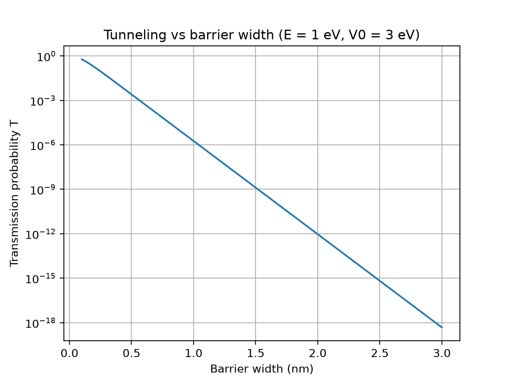
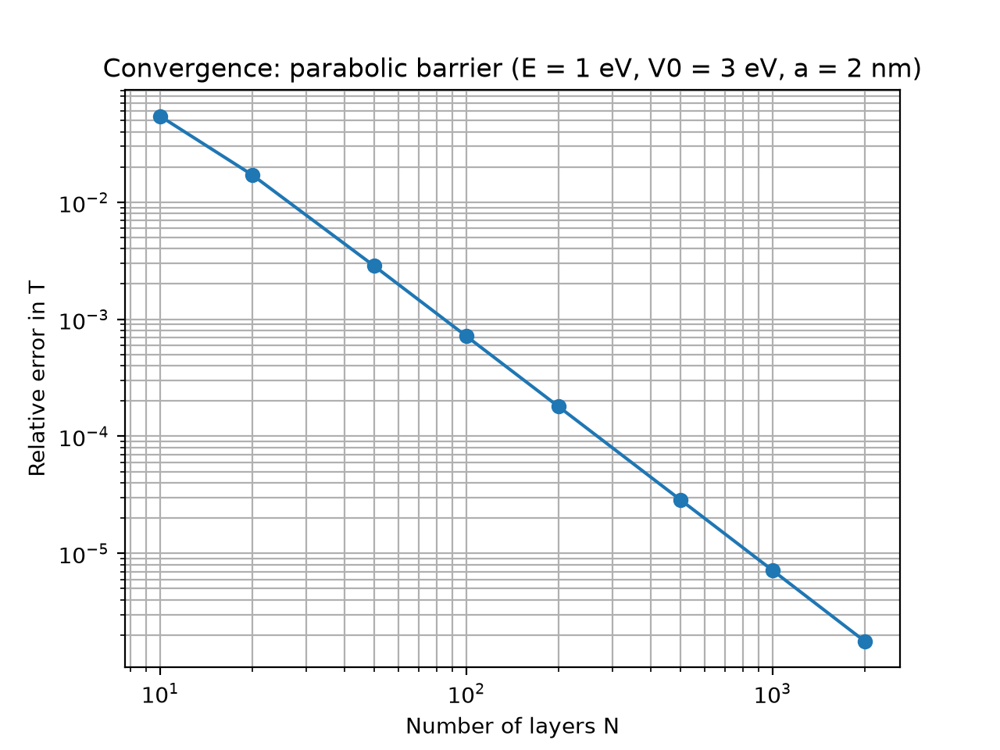
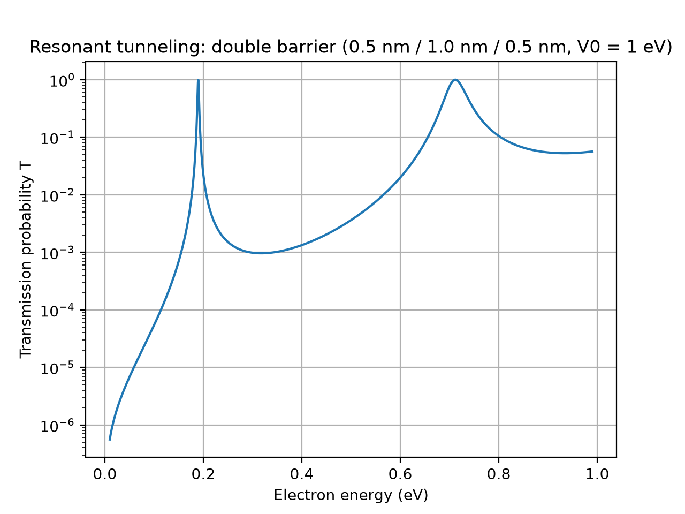

# Quantum Tunneling Simulator

A Python simulator for 1D quantum tunneling of an electron through arbitrary potential barriers, using the transfer-matrix method. It is validated against the analytic solution for a rectangular barrier and extended to a double-barrier (resonant tunneling) structure.

## Why tunneling matters
Electrons can pass through energy barriers that classical physics says they cannot cross. In chips, this causes leakage current through very thin insulating layers, and it is also the mechanism behind flash memory.

## Method
- **Analytic solution:** closed-form transmission probability for a rectangular barrier (`T_analytic`).
- **Numerical solver:** the barrier is split into thin layers of constant potential. The wavefunction and its derivative are matched at each boundary, and the 2x2 transfer matrices are multiplied together to get the transmission T and reflection R (`T_numeric`, `R_numeric`). This works for any barrier shape.
- Units: eV and nm, with hbar^2/(2m) = 0.0381 eV nm^2 (free electron mass).

## Results

### 1. Tunneling decays exponentially with barrier width


For E = 1 eV and V0 = 3 eV, T falls by roughly a factor of 1000 for every extra 0.5 nm of barrier.

### 2. Validation
- The numerical solver matches the analytic result for rectangular barriers to a relative tolerance of 1e-8 (tested for several energies and widths).
- Probability is conserved: T + R = 1 to within 1e-9, including for curved barriers.
- On a parabolic barrier, which has no closed-form solution, the error converges as roughly 1/N^2 in the number of layers N (compared against a 20,000-layer reference run).



### 3. Resonant tunneling in a double barrier
Two 0.5 nm barriers (V0 = 1 eV) separated by a 1.0 nm well show sharp transmission peaks near 0.19 eV and 0.71 eV, where T approaches 1 even though each barrier alone blocks almost everything. Peak spacing is consistent with the quantized levels of the well, and the peak near the barrier top is broader, as expected.



## Limitations
- 1D, time-independent, single particle; no scattering, temperature, or electron-electron effects.
- Uses the free electron mass and round-number parameters. Real devices use effective masses and material-specific barrier heights (for example GaAs/AlGaAs), so this is a simplified model, not a device simulation.
- The convergence reference for curved barriers is the same solver at high resolution, since no analytic answer exists. Correctness is established by the rectangular-barrier comparison.

## Run it
```
pip install numpy matplotlib pytest
python plot_width.py
python plot_convergence.py
python plot_resonant.py
python -m pytest
```

## Files
- `src/tunneling.py`: analytic and numerical solvers
- `tests/test_tunneling.py`: validation tests
- `plot_*.py`: scripts that generate the figures